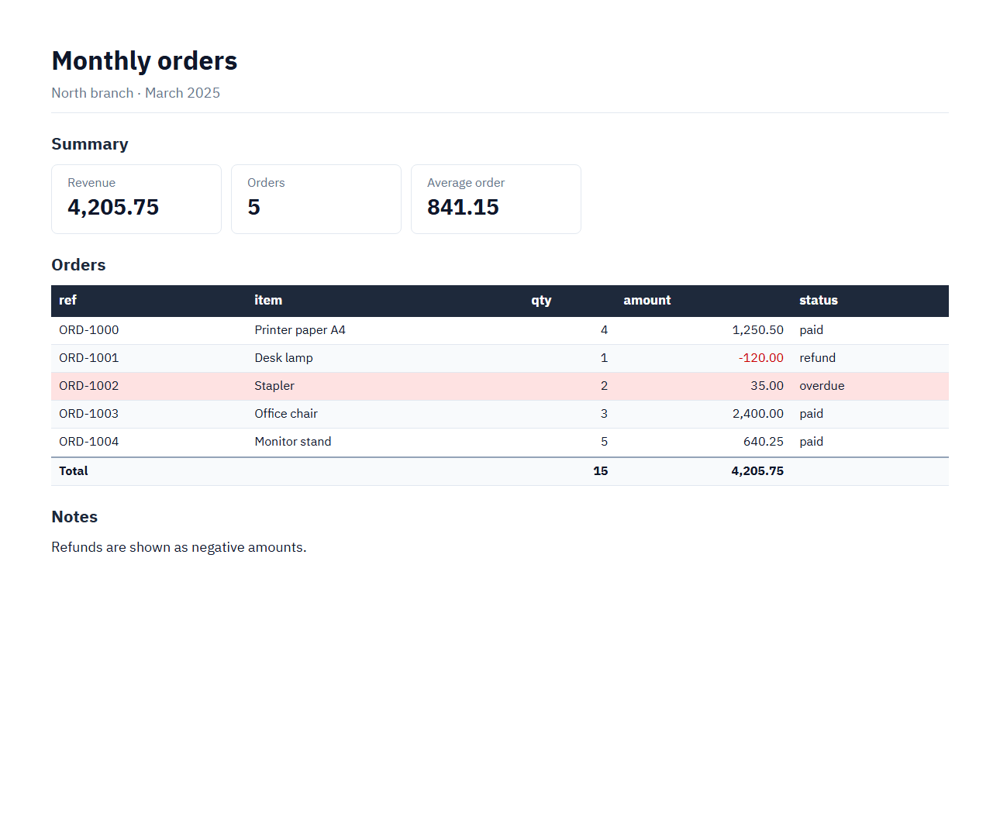
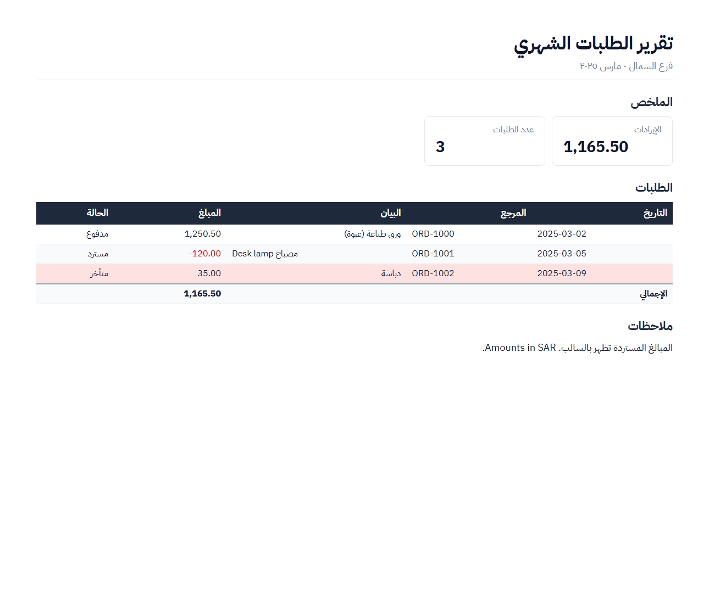

# reportspec

**One JSON spec in, a print-ready PDF and a real Excel workbook out. Arabic and right-to-left documents work without extra setup.**

Describe the report as data: metric cards, tables, notes. Pass the rows, and reportspec does the formatting work everyone rewrites:

- Number parsing (`"1,250.50"`, `"(120.00)"`, `"١٬٢٥٠٫٥٠"`) and formatting, with negatives in red.
- Totals rows and conditional row highlights.
- Landscape pages for wide tables, page numbers, and repeated table headers.
- An Excel file with *numbers* in it, not text: formats, frozen header, autofilter.
- Right-to-left layout, Arabic labels and dates that display correctly when the content is Arabic.

| English | Arabic (RTL, detected automatically) |
|---|---|
|  |  |

The PDFs these previews come from are in [`examples/`](examples) (the previews are HTML renders; the PDFs add page margins and the page-number footer).

```python
import reportspec as rs

spec = {
    "title": "Monthly orders",
    "footer": "Generated 2025-03-31",
    "sections": [
        {"type": "metrics", "title": "Summary", "items": [
            {"label": "Revenue", "data": "orders", "column": "amount", "fn": "sum"},
            {"label": "Orders", "data": "orders", "fn": "rows"}]},
        {"type": "table", "title": "Orders", "data": "orders",
         "number_columns": ["qty", "amount"], "totals": True,
         "highlight": {"column": "status", "map": {"overdue": "red", "refund": "yellow"}}},
        {"type": "text", "title": "Notes", "body": "Refunds are shown as negative amounts."},
    ],
}
data = {"orders": rows}          # a list of dicts, or a pandas DataFrame

rs.render_pdf(spec, data, "report.pdf")
rs.render_xlsx(spec, data, "report.xlsx")
html = rs.render_html(spec, data)   # standalone HTML, no native libraries needed
```

## Install

```bash
pip install "reportspec @ git+https://github.com/mazin01/reportspec"
```

PDF output uses [WeasyPrint](https://weasyprint.org), which needs the Pango library from the OS:

- **Linux / WSL:** `apt install libpango-1.0-0 libpangoft2-1.0-0 libharfbuzz-subset0`. Many systems already have it.
- **macOS:** `brew install pango`.
- **Windows:** see [WeasyPrint's install guide](https://doc.courtbouillon.org/weasyprint/stable/first_steps.html#windows), or run in WSL.

`render_html` and `render_xlsx` work everywhere without Pango.

## Spec

| key | meaning |
|---|---|
| `title`, `subtitle` | report heading |
| `footer` | text at the bottom right of every PDF page |
| `direction` | `"auto"` (default; RTL if the title, a section title or a column name reads right-to-left), `"rtl"` or `"ltr"` |
| `page` | CSS page size, e.g. `"A4"` or `"Letter landscape"`. Default A4, landscape when a table has 7 or more columns |
| `labels` | override `{"page", "of", "total"}`. Defaults are English, or Arabic in RTL documents |
| `sections` | a list of the sections below |

**`metrics`:** `items` of `{"label", "data", "column", "fn"}` with `fn` one of `sum` / `avg` / `min` / `max` / `count` (non-empty numbers) / `rows`, or a fixed `{"label", "value"}`. Optional `decimals`.

**`table`:** `data` (a dataset name), plus the optional keys below.
- `columns`: subset and order; default is all columns.
- `number_columns` and `percent_columns`: `12.5` is shown as `12.50%` and written to Excel as `0.125` with a `%` format.
- `totals`: sums the number columns.
- `decimals`: by default 0 for whole-number columns and 2 otherwise.
- `negative_red`: default true.
- `highlight`: `{"column": "status", "map": {"overdue": "red"}}`, with colours `green`, `yellow`, `red`, `orange` and `blue`.

**`text`:** `body`, rendered with line breaks preserved.

Every section can have a `title`. Data values can be strings or numbers. Number columns are parsed with [nuqta](https://github.com/mazin01/nuqta): thousands separators, `(1,250.00)` accounting negatives, and Arabic-Indic digits.

## Arabic and RTL, specifically

- **Bundled font:** [IBM Plex Sans Arabic](https://github.com/IBM/plex) (SIL OFL 1.1, licence in `reportspec/fonts/OFL.txt`) covers Arabic and Latin, so the output doesn't depend on the fonts installed on the machine.
- **Per-cell direction:** an English cell inside an Arabic table (`Desk lamp`) gets `dir="ltr"`, numbers are always LTR, and headers align to the reading start.
- **Dates in Arabic text:** under the Unicode Bidirectional Algorithm, a date that follows an Arabic word becomes an "Arabic number", and the `-` no longer holds it together, so `أُنشئ في 2025-03-31` would display as `31-03-2025`. In RTL documents reportspec wraps dates in Unicode isolates (LRI…PDI), so they display as written.
- **Excel:** RTL documents get right-to-left sheets, and the totals label becomes `الإجمالي`.

## CLI

```bash
reportspec spec.json --data orders=orders.csv --pdf report.pdf --xlsx report.xlsx
```

`--data NAME=FILE` accepts `.csv` (encoding detected, including Windows-1256) or `.json` (a list of objects). Errors are JSON with a stable code, and the exit status is 2.

## Errors

`reportspec.SpecError` has `.code` and `.details`: `BAD_SPEC`, `UNKNOWN_SECTION_TYPE`, `MISSING_DATA`, `BAD_DATA` or `COLUMN_NOT_FOUND` (which lists the available columns). `validate(spec, data)` checks everything without rendering.

## Use cases

- Monthly management, sales or inventory reports from a script or a scheduled job.
- Statements and summaries for clients in Arabic and English from the same spec.
- LLM agents and tools: a model writes the small JSON spec instead of HTML or Excel code, and the formatting stays consistent.

## Development

```bash
pip install -e ".[test]"
pytest                          # PDF tests skip themselves when Pango isn't available
python examples/make_examples.py
```

## License

MIT for the code. The bundled IBM Plex Sans Arabic font is under the SIL Open Font License 1.1.
